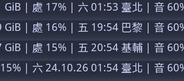

# world-clock

A polybar clock that cycles through time zones when you click it.



- **Left click**: next time zone
- **Middle click**: show or hide the full date
- Clicks update the clock immediately
- Daylight saving time is handled for you; labels can be anything, e.g. city names in any language

Requires only `bash` and `date` (coreutils).

## Install

Copy the script into your polybar scripts folder and make it executable:

```sh
cp world-clock.sh ~/.config/polybar/scripts/
chmod +x ~/.config/polybar/scripts/world-clock.sh
```

Add a module to your polybar config:

```ini
[module/world-clock]
type = custom/script
exec = ~/.config/polybar/scripts/world-clock.sh "Asia/Taipei:臺北" "Europe/Paris:巴黎" "Europe/Kyiv:基輔"
tail = true
click-left = kill -USR1 %pid%
click-middle = kill -USR2 %pid%
```

Then add `world-clock` to `modules-left`, `modules-center` or `modules-right` of your bar.
`tail = true` is required: the script keeps running and polybar passes its PID as `%pid%`.

## Options

```
world-clock.sh [-s FORMAT] [-l FORMAT] [-i SECONDS] ZONE[:LABEL]...
```

| Argument | Meaning | Default |
|---|---|---|
| `ZONE` | An IANA time zone, e.g. `Europe/Paris` (see `/usr/share/zoneinfo`) | |
| `LABEL` | Text shown after the time | city part of the zone, e.g. `Paris` |
| `-s FORMAT` | Short format, shown by default | `%a %H:%M` |
| `-l FORMAT` | Long format, shown after a middle click | `%a %d.%m.%Oy %H:%M` |
| `-i SECONDS` | How often to refresh | `5` |

Formats use `date` syntax (see `man date`). Weekday and month names follow your locale (`LC_TIME`).

The first zone is shown at start. An unknown zone prints an error instead of silently showing UTC.

### Examples

```ini
; labels default to city names: "Sat 01:52 Taipei"
exec = ~/.config/polybar/scripts/world-clock.sh Asia/Taipei Europe/London America/New_York

; 12-hour clock, ISO date when expanded
exec = ~/.config/polybar/scripts/world-clock.sh -s "%I:%M %p" -l "%F %I:%M %p" Asia/Tokyo:Tokyo UTC:UTC
```

## Signals

You can drive the clock from anything, not just polybar clicks:

| Signal | Effect |
|---|---|
| `USR1` | Next time zone |
| `USR2` | Toggle short / long format |

```sh
pkill -USR1 -f world-clock.sh
```

## License

MIT, see [LICENSE](LICENSE).
